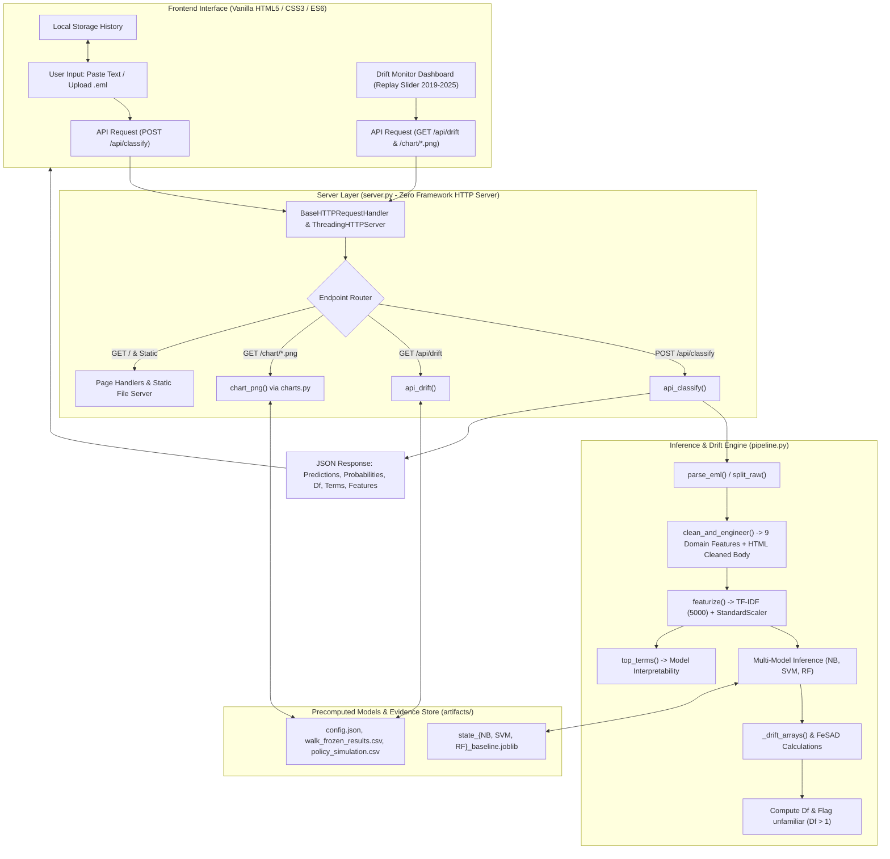

# PhishDrift: Comprehensive Project Documentation & Technical Architecture

---

## 1. Executive Summary & Core Project Idea

### 1.1 The Core Problem: Concept & Feature Drift in Phishing Detection
Machine learning models trained to classify emails as phishing or legitimate suffer from performance degradation over time. While a newly trained model may achieve upwards of 96%–97% recall and accuracy on contemporary test datasets, its effectiveness inevitably decays as the real-world threat landscape evolves.

This degradation is driven by two intertwined phenomena:
1. **Feature Drift (Covariate Shift):** The distribution of email features changes over time. Attackers continually update phishing email structures, phrasing, formatting, subject lines, domain naming tricks, and evasion techniques. Concurrently, legitimate email formats change as organizations adopt new communication tools, marketing templates, and automated transaction notifications.
2. **Concept Drift:** The statistical relationship between input features and target labels changes over time. Words or structures previously indicative of legitimate communication might become common in spear-phishing campaigns, while traditional phishing keywords might be adopted by aggressive modern marketing.

Without continuous monitoring, security teams remain unaware of model obsolescence until malicious emails bypass the filter into user inboxes. Conversely, retraining models too frequently or on arbitrary schedules (e.g., weekly or monthly) incurs unnecessary computational cost, risks catastrophic forgetting, and may introduce instability from small or unrepresentative batches.

### 1.2 The PhishDrift Solution
**PhishDrift** is an explainable machine learning email classifier paired with an active **drift monitoring and triggered retraining engine**. It addresses the drift problem through an adapted implementation of the **FeSAD (Feature and Sample Drift)** framework, inspired by the research by Fernando & Komninos (*Evaluating and Combatting the Impact of Concept Drift on the Performance of Machine Learning-Based Phishing Detection Systems*, arXiv:2606.11471; adapted from earlier work in ransomware drift).

Rather than treating classification as a static black box, PhishDrift introduces three operational layers:
1. **Multi-Model Consensus Layer:** Evaluates each email concurrently across three diverse algorithmic families—Multinomial Naive Bayes (NB), Calibrated Support Vector Machines (SVM), and Random Forest (RF).
2. **FeSAD Drift & Familiarity Scoring Layer:** Computes an individualized per-sample drift score ($D_f$) for every incoming email based on class centroid cosine distances, prediction confidence, and baseline error profiles calibrated on a reference dataset. Emails with $D_f > 1$ are flagged as **abnormal / unfamiliar**, alerting users that the model is making an inference outside its familiar training distribution.
3. **Temporal Drift Replay & Triggered Retraining Monitor:** Replays multi-year operational data (evaluating annual batches from 2019 to 2025 against models trained on 2015–2017 and calibrated on 2018). It detects when the batch-level proportion of abnormal samples exceeds calibrated safety thresholds, issuing an actionable recommendation to retrain the model.
4. **Transparent Explainability Layer:** Provides directional term-level explanations (for NB and SVM) and feature importances (for RF) alongside extracted feature heuristics, enabling human reviewers to understand *why* an email was classified and *what* drove the decision.

---

## 2. System Architecture & High-Level Workflow

The diagram below illustrates how an email traverses the system, from raw input to feature engineering, classification, drift evaluation, and explainability.



---

## 3. Mathematical Foundations: The Adapted FeSAD Framework

PhishDrift adapts the FeSAD framework to quantify feature drift without requiring true labels at inference time.

### 3.1 Class Centroids & Cosine Distance Ratio
Let $X \in \mathbb{R}^d$ be the normalized feature representation of an email. Let $\hat{\mu}_m$ and $\hat{\mu}_b$ denote the normalized centroid vectors of the malicious (phishing) and benign (legitimate) classes calculated from training data:
$$\hat{\mu}_m = \frac{\sum_{i \in \text{phish}} X_i}{\|\sum_{i \in \text{phish}} X_i\|_2}, \quad \hat{\mu}_b = \frac{\sum_{j \in \text{legit}} X_j}{\|\sum_{j \in \text{legit}} X_j\|_2}$$

For any input sample $x$, the cosine distances to the malicious and benign centroids are:
$$d_m(x) = 1 - \hat{x} \cdot \hat{\mu}_m$$
$$d_b(x) = 1 - \hat{x} \cdot \hat{\mu}_b$$

The raw distance ratio $r_i$ measures the relative proximity of sample $x_i$ to malicious versus benign regions:
$$r_i = \frac{d_m(x_i) + \epsilon}{d_b(x_i) + \epsilon} \quad (\text{with } \epsilon = 10^{-9} \text{ for numerical stability})$$
- When $r_i \ll 1$, the sample is much closer to the phishing centroid.
- When $r_i \gg 1$, the sample is much closer to the benign centroid.

### 3.2 Confidence Weighting
To prevent high-confidence predictions from being unduly distorted, the distance ratio is weighted by the model's confidence relative to historical error rates:
Let $p_1 = P(y=1 \mid x_i)$ be the predicted probability of phishing. The predicted class is:
$$\hat{y}_i = \begin{cases} 1 & \text{if } p_1 \ge 0.5 \\ 0 & \text{otherwise} \end{cases}$$
The operational confidence is defined as:
$$p_i = \begin{cases} p_1 & \text{if } \hat{y}_i = 1 \\ 1 - p_1 & \text{if } \hat{y}_i = 0 \end{cases}$$
Let $\bar{p}_{\text{wrong}, m}$ and $\bar{p}_{\text{wrong}, b}$ be the average probability of misclassified samples during cross-validation on the training set for phishing and benign predictions, respectively. The weights are:
$$w_{m, i} = \frac{p_i}{\bar{p}_{\text{wrong}, m}}, \quad w_{b, i} = \frac{p_i}{\bar{p}_{\text{wrong}, b}}$$

The weighted log-distance ratio $dw_i$ is computed as:
$$dw_i = \begin{cases} \ln\left(\frac{r_i}{w_{m, i}}\right) & \text{if } \hat{y}_i = 1 \\ \ln\left(r_i \cdot w_{b, i}\right) & \text{if } \hat{y}_i = 0 \end{cases}$$

### 3.3 Directional Shift & Calibration-Normalized Drift Score ($D_f$)
During calibration on a held-out dataset (the 2018 batch), baseline reference shifts are established: $\bar{dw}_{\text{calib}, m}$ and $\bar{dw}_{\text{calib}, b}$.
Directional drift measures how far the sample has drifted toward the *opposite* class:
$$D_i = \begin{cases} dw_i - \bar{dw}_{\text{calib}, m} & \text{if } \hat{y}_i = 1 \text{ (shift toward benign)} \\ \bar{dw}_{\text{calib}, b} - dw_i & \text{if } \hat{y}_i = 0 \text{ (shift toward phishing)} \end{cases}$$

To make this metric dimensionless and comparable across models, $D_i$ is normalized by the class-specific calibration error margin $De_c$:
$$De_m = \text{mean}(|D_{\text{calib}, m}|) \cdot f_m, \quad De_b = \text{mean}(|D_{\text{calib}, b}|) \cdot f_b$$
where $f_m, f_b \ge 1.0$ represent empirical expansion factors from calibration.

The final **per-sample drift score** is:
$$D_f(x_i) = \frac{D_i}{De_{\hat{y}_i}}$$

**Interpretation:**
- $D_f \le 1.0$: The email falls within expected calibration dispersion (Normal / Familiar).
- $D_f > 1.0$: The email represents an **abnormal sample**, deviating further from historical norms than observed in calibration.

### 3.4 Batch Monitoring & Triggered Retraining Rules
In operational monitoring over time batches (years $t \in [2019, 2025]$), the system tracks:
$$\text{abn\_pct}_t = \frac{1}{N_t} \sum_{i=1}^{N_t} \mathbb{I}(D_{f, i} > 1.0)$$

With predefined warning threshold $\tau_{\text{warn}}$ and retraining threshold $\tau_{\text{retrain}}$ derived during calibration (calibration abnormal percentage + margin):
- $\text{abn\_pct}_t < \tau_{\text{warn}} \implies \textbf{Status: Normal}$
- $\tau_{\text{warn}} \le \text{abn\_pct}_t < \tau_{\text{retrain}} \implies \textbf{Status: Abnormal Drift}$
- $\text{abn\_pct}_t \ge \tau_{\text{retrain}} \implies \textbf{Status: Retrain Recommended}$

---

## 4. Technology Stack & Dependencies

| Component | Technology | Rationale & Purpose |
| :--- | :--- | :--- |
| **Runtime Language** | Python 3.10+ | Compatibility with modern scikit-learn and typed scientific computing |
| **Web Framework** | Python Standard Library (`http.server`) | **Zero-framework design**. Avoids heavy dependencies like Flask, FastAPI, or Streamlit; lightweight, fast boot times, and completely self-contained |
| **Concurrency & Thread Safety** | `threading.Lock`, `ThreadingHTTPServer` | Serializes Matplotlib figure rendering and scikit-learn inference to prevent C-extension race conditions |
| **ML & Serialization** | `scikit-learn==1.6.1`, `joblib` | Exact version pinning to ensure unpickling compatibility with the pre-trained `.joblib` pipelines |
| **Data Processing** | `pandas`, `numpy`, `scipy` | Sparse matrix operations (`scipy.sparse.csr_matrix`, `hstack`), vector normalization, array manipulation, and Spearman correlation |
| **Email & Text Parsing** | `email.parser`, `email.policy`, `beautifulsoup4`, `re` | RFC-compliant `.eml` parsing, plain/HTML text extraction, HTML stripping, regex-based header splitting |
| **Data Visualization** | `matplotlib` (using `Agg` headless backend) | Server-side chart generation directly to in-memory PNG buffers (`io.BytesIO`) without GUI display dependencies |
| **Frontend Architecture** | Vanilla HTML5, CSS3, ES6 JavaScript | Zero build step (no Webpack, Vite, or Node.js required); native CSS custom properties, grid layouts, SVG icons, and `localStorage` caching |
| **Automation Scripts** | Windows Batch (`run.bat`) | One-click launch for Windows environments |

---

## 5. Directory & File Structure

```
phish_drift_ui/
│
├── server.py                   # Main HTTP web server, routing, API endpoints, page templates
├── pipeline.py                 # Core ML inference engine, text cleaning, FeSAD drift scoring, top terms
├── charts.py                   # Server-side Matplotlib chart rendering (headless Agg backend -> PNG bytes)
├── export_inbox.py             # CLI utility for extracting and scrubbing modern legitimate email datasets
│
├── run.bat                     # Windows batch script to launch the server and open the browser
├── requirements.txt            # Python dependencies specification (pinned scikit-learn==1.6.1)
├── README.txt                  # Quick-start instructions for local setup and notebook output integration
│
├── artifacts/                  # Model checkpoints and precomputed research evaluation data
│   ├── config.json             # Experiment hyperparameters, training/calibration/walk years, thresholds
│   ├── state_NB_baseline.joblib  # Serialized Naive Bayes model, TF-IDF vectorizer, scaler, centroids
│   ├── state_SVM_baseline.joblib # Serialized Calibrated LinearSVC pipeline and FeSAD parameters
│   ├── state_RF_baseline.joblib  # Serialized Random Forest pipeline and FeSAD parameters
│   ├── detector_eval.csv       # Confusion matrix metrics: FeSAD weighted detector vs Cosine centroid
│   ├── drift_vs_recall_spearman.csv # Spearman rank correlation: drift metrics vs empirical recall drop
│   ├── modern_legit_fp.csv     # False-positive evaluation on modern inbox emails
│   ├── per_sample_Df_frozen.csv# Detailed per-email drift scores across the 2019-2025 evaluation walk
│   ├── policy_simulation.csv   # Annual recall and accuracy across 4 retraining policies
│   ├── policy_summary.csv      # Aggregated policy benchmarks: mean recall, minimum recall, retrain counts
│   └── walk_frozen_results.csv # Annual frozen baseline metrics (accuracy, precision, recall, abn_pct, etc.)
│
└── web/                        # Static UI assets served by server.py
    ├── logo.svg                # Brand SVG vector icon
    ├── style.css               # Complete styling system, CSS variables, dark/light tones, card layouts
    └── main.js                 # Frontend application logic: classification client, drift slider, history
```

---

## 6. Deep Dive: File-by-File Technical Breakdown

### 6.1 `server.py`
The central orchestration layer of the application.

#### Key Modules & Classes:
- **`ThreadingHTTPServer` & `Handler(BaseHTTPRequestHandler)`:**
  Provides standard HTTP request handling without third-party frameworks.
  - Implements `do_GET()` to serve HTML pages (`/`, `/drift`, `/evidence`, `/history`, `/about`), static assets (`/static/*`), API drift metadata (`/api/drift`), and dynamic PNG charts (`/chart/*.png`).
  - Implements `do_POST()` to handle `/api/classify` requests.
- **State & Table Management:**
  - `_STATES`: In-memory dictionary holding lazy-loaded `joblib` artifacts for each model (`NB`, `SVM`, `RF`).
  - `_TABLES`: In-memory cache holding pandas DataFrames loaded from `artifacts/*.csv` and settings from `config.json`.
  - `LOCK = threading.Lock()`: Serializes access to `matplotlib` and model prediction calls, guaranteeing thread safety during concurrent browser requests.
- **HTML Page Generators:**
  - `layout(active, body, title, scripts)`: Master HTML wrapper with sidebar navigation, brand logo, user indicator, and responsive grid layout.
  - `page_home()`: Renders the email submission workbench (dual-tab paste/upload pane, sample email selector, action buttons, and classification cards).
  - `page_drift()`: Renders the historical replay interface with model selector, state selector (Frozen vs. Retrained), year scrubber slider, statistical status cards, and live chart viewers.
  - `page_evidence()`: Renders deep-dive validation tables (Spearman correlation, policy simulation comparison, detector accuracy, modern legitimate false-positive rates).
  - `page_history()`: Displays client-side classification logs stored in `localStorage`.
  - `page_about()`: Explains the theoretical framework, academic references, mathematical formulas, and dataset details.
- **API Endpoints:**
  - `api_classify(payload)`: Parses incoming JSON payload, routes text through `pipeline.py`, executes inference across available models, formats feature heuristics, extracts top directional terms, and returns a composite classification result.
  - `api_drift(query_params)`: Retrieves specific yearly data points from `walk_frozen_results.csv`, `policy_simulation.csv`, and `per_sample_Df_frozen.csv`, providing real-time metrics to the frontend slider.
  - `chart_png(name, query_params)`: Delegates chart generation to `charts.py` and streams binary PNG images with appropriate `image/png` headers.

---

### 6.2 `pipeline.py`
The machine learning pipeline responsible for text preprocessing, feature extraction, model prediction, FeSAD drift scoring, and local interpretability.

#### Key Functions & Heuristics:
- **Email Parsing:**
  - `parse_eml(raw_bytes)`: Uses Python's standard `BytesParser` with `policy.default` to extract RFC headers (`Subject`, `From`) and plain-text/HTML body segments.
  - `split_raw(text)`: Intelligently separates prepended header lines (e.g., pasted raw text starting with `Subject:` or `From:`) from the body text.
- **Text Cleaning & Feature Engineering:**
  - `_strip_html(t)`: Uses `BeautifulSoup` (or a regex fallback) to extract raw text from HTML email bodies while normalizing whitespace.
  - `urgency_score(text)`: Measures the presence of high-risk urgency phrases (`"verify"`, `"urgent"`, `"account locked"`, `"click here"`, `"suspend"`, `"immediately"`, `"act now"`, `"confirm your"`, `"limited time"`, `"expire"`).
  - `caps_ratio(text)`: Calculates the ratio of uppercase alphabetical characters to total alphabetical characters.
  - `sender_domain_suspicious(sender)`: Domain heuristic score that increments if:
    1. The domain exceeds 25 characters.
    2. Contains 2 or more hyphens.
    3. Contains 3 or more digits.
    4. Does not use standard reputable TLDs (`.com`, `.org`, `.net`, `.edu`, `.gov`).
  - `clean_and_engineer(raw)`: Returns a clean body string along with 9 engineered numerical features:
    `body_len`, `word_count`, `url_count`, `exclaim_count`, `caps_ratio`, `urgency_score`, `subject_len`, `subject_has_urgency`, `sender_domain_suspicious`.
- **Vectorization & Featurization:**
  - `featurize(feat, d)`: Transforms the cleaned email body using the training-fit `TfidfVectorizer` (5,000 unigram/bigram terms) and standardizes the 9 engineered features using `StandardScaler`. The two representations are concatenated into a sparse matrix via `scipy.sparse.hstack`.
- **Drift Calculation (`_drift_arrays`):**
  - Implements the mathematical formulas described in Section 3 (`dist_ratio`, `weighted_dist`, `directional_drift`), producing per-sample drift scores $D_f$.
- **Explainability (`top_terms`):**
  - **Naive Bayes:** Computes log-probability ratios:
    $$w = \log P(\text{term} \mid \text{phishing}) - \log P(\text{term} \mid \text{legit})$$
    Terms with positive contributions push toward phishing; negative contributions push toward legitimate.
  - **SVM:** Extracts average coefficients across calibrated ensemble estimators (`LinearSVC` base estimators):
    $$w = \frac{1}{K}\sum_{k=1}^K \text{coef}_k$$
    Multiplied by the sample's non-zero feature values to display directional contribution.
  - **Random Forest:** Extracts tree-based Gini feature importances, showing the most influential terms for that specific decision.
- **Entry Point (`predict_email`):**
  - Combines cleaning, vectorization, multi-model probability estimation, FeSAD drift scoring, and term ranking into a unified output dictionary.

---

### 6.3 `charts.py`
Dedicated plotting module utilizing `matplotlib` in headless mode (`Agg` backend).

#### Design System & Functions:
- **Styling Standards:** Custom aesthetic matching the web palette (dark ink `#17211C`, muted green `#2B7A6B`, warn gold `#B7791F`, alert red `#B42318`, background line `#E3E1D8`). Generates clean 140 DPI graphics with borders stripped and subtle horizontal grids.
- **Core Visualizations:**
  - `fig_drift(w, year, thr, warn, years)`: Plots the annual percentage of abnormal samples over time (2019–2025). Displays a shaded warning zone and dashed red line for the retrain threshold, highlighting the current year's status.
  - `fig_recall(frozen, trig, control, years, year, lo)`: Compares the phishing recall of the frozen baseline against the triggered retraining policy, with a reference dotted line for train-era control recall and shaded recall drop regions.
  - `fig_hist(ps)`: Displays the distribution of per-sample $D_f$ scores for legitimate versus phishing emails in a given year, marking the abnormal boundary at $D_f = 1.0$.
  - `fig_terms(t)`: Horizontal bar chart visualizing top directional terms pushing toward legitimate (green) versus phishing (red).
  - `fig_evidence_recall(piv, ctrl)`: Multi-model timeline comparing frozen recall degradation across Naive Bayes, SVM, and Random Forest.
  - `fig_policy(sim_sum)`: Scatter plot comparing the mean phishing recall across four retraining policies (Frozen, Triggered, Retrain Every 2 Years, Retrain Every Year).

---

### 6.4 `export_inbox.py`
A stand-alone CLI data preparation utility designed to solve legitimate class bias.

#### Problem Context:
The original training set pairs modern phishing emails (Nazario dataset) with historical legitimate emails from the Enron dataset (early 2000s). This risks models learning anachronistic linguistic styles ("old corporate English" vs. "modern automated notifications") rather than phishing markers.
`export_inbox.py` allows researchers to extract and scrub modern legitimate emails from personal Gmail Takeout `.mbox` files or `.eml` folders to create a balanced validation set (`modern_legit.csv`).

#### Privacy & Data Scrubbing Features:
- **Heuristic Skipping:** Automatically skips sensitive emails containing keywords such as `"otp"`, `"password"`, `"bank"`, `"salary"`, `"aadhaar"`, `"credit card"`, `"tax"`, or `"medical"`.
- **Cap Per Sender:** Limits emails to a maximum number per domain (e.g., `--max-per-sender 12`) to prevent high-frequency senders from dominating the dataset.
- **PII Redaction:**
  - Replaces phone numbers with `<phone>`.
  - Replaces long numerical strings with `<num>`.
  - Redacts email usernames (`user@domain.com`).
  - Strips URL paths while preserving domains (`https://example.com/`).
  - Redacts custom names provided via `--redact <name>`.

---

### 6.5 `web/main.js` & `web/style.css`
The front-end client layer.

#### JavaScript Features:
- **Home View:** Handles tab navigation between direct paste and file upload; implements drag-and-drop file readers; updates live character counters; calls `/api/classify`; parses response JSON to render color-coded verdict badges, probability meters, unfamiliarity warnings, term contribution breakdown tables, and extracted feature tables.
- **Local History View:** Persists classified emails into the browser's `localStorage` (`phishdrift_history_v1`) without sending private logs back to the server; provides clear-history functionality.
- **Drift Monitor View:** Binds the year slider, model selector buttons, and frozen/retrained toggle; calls `/api/drift` asynchronously to update status indicators, statistical metric cards, and dynamic chart images with cache-busting timestamps.

#### CSS System:
- Pure CSS design with custom properties: `--bg`, `--surface`, `--ink`, `--muted`, `--line`, `--accent`, `--bad`, `--good`, `--warn`.
- Structured using modern CSS Grid (`grid-2`, `grid-2c`, `grid-4`) and Flexbox layouts.
- Zero external CSS libraries (no Bootstrap or Tailwind); fully self-contained and performant.

---

### 6.6 Artifacts & Precomputed Research Data (`artifacts/`)

1. **`config.json`:**
   Stores global experiment parameters:
   - Training years: `[2015, 2016, 2017]`
   - Calibration year: `2018`
   - Walk years: `[2019, 2020, 2021, 2022, 2023, 2024, 2025]`
   - Calibrated metrics per model: baseline control recall, control accuracy, expansion factors ($f_m, f_b$), calibration error scale ($De_m, De_b$), and retrain/warning thresholds.
2. **`state_{NB, SVM, RF}_baseline.joblib`:**
   Pre-trained pipeline states containing:
   - `model`: The trained scikit-learn classifier (`MultinomialNB`, calibrated `LinearSVC`, or `RandomForestClassifier`).
   - `feat`: Dict containing the fitted `TfidfVectorizer` and `StandardScaler`.
   - `mu_m`, `mu_b`: Class centroid vectors.
   - `pbar_m`, `pbar_b`: Historical training error probabilities.
   - `dwbar_mc`, `dwbar_bc`: Calibration reference weighted distances.
   - `De_m`, `De_b`: Class-specific calibration error denominators.
3. **`detector_eval.csv`:**
   Evaluates the FeSAD weighted detector against an unweighted Cosine centroid baseline. Shows that FeSAD significantly reduces false alarms while maintaining high true positive rates for drift detection.
4. **`drift_vs_recall_spearman.csv`:**
   Records the Spearman rank correlation between the drift metrics ($D_f$, abnormal percentage) and empirical recall drop across years, showing strong positive correlations (e.g., $r_s \approx 0.96$ for SVM mean $D_f$).
5. **`policy_summary.csv` & `policy_simulation.csv`:**
   Records longitudinal performance of retraining policies:
   - **Frozen:** No retraining. Phishing recall degrades from ~96% down to 82%–84%.
   - **Triggered:** Retraining triggered only when drift is flagged (1 retrain total across 7 years). Recovers recall to 91%–92%.
   - **Every 1 Year:** Mandatory annual retraining (6 retrains). Achieves ~91%–93% recall.
   *Key Research Takeaway:* Triggered retraining achieves equivalent performance to annual retraining with an 83% reduction in retrain overhead.
6. **`modern_legit_fp.csv`:**
   Documents false-positive rates when tested on modern legitimate inbox emails (highlighting the Enron dataset limitation).

---

## 7. Setup & Execution Guide

### 7.1 Prerequisites
- **Operating System:** Windows, macOS, or Linux.
- **Python:** Python 3.10 or higher.
- **Python Package Manager:** `pip`.

### 7.2 Installation
1. Open a terminal / PowerShell window and navigate to the project directory:
   ```powershell
   cd C:\Users\hp\Downloads\phish_drift_ui
   ```
2. Install the required dependencies:
   ```powershell
   pip install -r requirements.txt
   ```
   > [!IMPORTANT]
   > Ensure that `scikit-learn==1.6.1` is installed exactly. Mismatched scikit-learn versions will fail to unpickle the `.joblib` model states.

### 7.3 Running the Web Application
- **Method 1 (Windows One-Click):** Double-click `run.bat`.
- **Method 2 (Command Line):**
  ```powershell
  python server.py
  ```
  The server will initialize on port 8000 and automatically open your default browser to:
  `http://localhost:8000`

#### Optional Command-Line Arguments:
- Specify a custom port:
  ```powershell
  python server.py --port 8080
  ```
- Headless execution (do not open browser automatically):
  ```powershell
  python server.py --no-browser
  ```

---

## 8. Experimental Insights & Limitations

### 8.1 Key Experimental Insights
1. **Concept Drift is Real and Measurable:** Without retraining, phishing recall drops steadily between 2019 and 2025 across all three classifiers (Random Forest recall drops by up to 14.5 points; SVM drops by up to 21 points).
2. **FeSAD Detects Drift Before Catastrophic Failure:** The per-sample drift score $D_f$ and batch abnormal percentage correlate strongly with empirical recall drops.
3. **Triggered Retraining is Computationally Efficient:** Retraining only when the drift detector crosses its threshold yields performance comparable to yearly retraining while executing only 1 retrain over 7 years instead of 6.

### 8.2 Documented Limitations
1. **The Enron Dataset Bias:** The legitimate training class is derived from the Enron corporate corpus (2000–2002). Modern automated emails (two-factor authentication notices, SaaS notifications, shipping confirmations) exhibit formatting patterns that did not exist in 2001, causing elevated false-positive rates on modern inboxes unless augmented via `export_inbox.py`.
2. **Small Batch Granularity:** The annual evaluation walk contains 7 batches (2019–2025). While directional trends are clear, statistical significance is indicative rather than definitive.
3. **Phishing Corpus Source:** The phishing emails are derived from the public Nazario corpus, which primarily captures bulk phishing rather than highly targeted spear-phishing campaigns.

---

## 9. Academic Metadata

- **Project Title:** PhishDrift: Feature-Drift Monitoring and Triggered Retraining for Phishing Email Classification
- **Academic Program:** Master of Computer Applications (MCA) Final Project
- **Institution:** Mar Athanasius College of Engineering, Kothamangalam
- **Project Guide:** Prof. Manu John
- **Project Team:**
  - Farisha N A
  - Sulfath P M
  - Adithya P Ganesh
- **Theoretical Basis:** Adapted from Fernando & Komninos (2026), *Evaluating and Combatting the Impact of Concept Drift on the Performance of Machine Learning-Based Phishing Detection Systems*, arXiv:2606.11471.
